# 🚀 Awesome Browser Automation & Semantic Web Agents

  

  
  
  
  
  

  <strong>A curated list of leading cloud browser infrastructures, autonomous semantic web agents, headless browser sandboxes, accessibility-tree navigators, and intelligent web scrapers.</strong>

---

## 📑 Table of Contents

- [🌐 Sector Overview & Market Dynamics](#-sector-overview--market-dynamics)
- [☁️ SaaS & Hosted Cloud Platforms](#️-saas--hosted-cloud-platforms)
- [💻 Open-Source Projects](#-open-source-projects)
- [📈 Star History](#-star-history)
- [🤝 How to Contribute](#-how-to-contribute)
- [💖 Support & Sponsor](#-support--sponsor)
- [📜 Disclaimer](#-disclaimer)

---

## 🌐 Sector Overview & Market Dynamics

The global web scraping and browser automation market is valued between **$1.1 billion and $1.6 billion** (expanding rapidly toward **$3.5B+ to $4B+** by 2030 at an estimated CAGR of 13%–18%), accelerated heavily by enterprise demand for generative AI training datasets, retrieval-augmented generation (RAG) pipelines, and autonomous agent web execution.

The market remains **moderately to highly fragmented** rather than a winner-take-all monopoly: while specialized cloud infrastructure and proxy vendors cater to high-scale data operations, the shift from brittle selector-based scrapers toward multimodal Vision-Language Model (VLM) accessibility-tree web agents continuously fosters rapid emergence of specialized point solutions and thriving open-source ecosystems.

---

## ☁️ SaaS & Hosted Cloud Platforms

Below is a structured overview of top managed browser infrastructure, headless Chrome execution grids, and web extraction APIs. The table is sorted in descending order by company size (valuation / estimated annual revenue).

| Platform | Starting Plan (Pricing) | Free Tier / Trial Limits | Company Scale (Valuation / Revenue) | Description |
| :--- | :--- | :--- | :--- | :--- |
| **[Browserbase](https://browserbase.com)** | **$20/mo** (Developer Plan, includes 100 hrs + 1 GB proxy) | **Forever Free**: 1 hr/month (60 mins), up to 3 concurrent browsers, 15-min max session duration | **$300M Valuation** (Series B, ~$3M–$4.4M ARR) | Cloud serverless headless browser infrastructure tailored for AI agents, featuring session replay, stealth proxies, and live DOM inspector. |
| **[Zyte](https://zyte.com)** | **Pay-As-You-Go** (~$1.01 per 1k browser-rendered requests; commitment plans from $100/mo) | **Free Trial**: $5 one-time credit valid for 30 days on sign-up (only successful requests billed) | **~$25M Annual Revenue** (Bootstrapped / $3M debt) | Enterprise cloud web data extraction platform combining AI-powered semantic parsing, headless browser rendering, and smart proxy management. |
| **[Apify](https://apify.com)** | **$19/mo** (Starter Plan, includes $19 platform usage credits) | **Forever Free**: $5 monthly prepaid usage credit, 16 GB max RAM per run, 5 datacenter proxy IPs | **~$13M Annual Revenue** (~$3.5M funding raised) | Cloud web scraping and browser automation platform featuring serverless Actors, residential proxies, and pre-built AI integrations. |
| **[ScrapingBee](https://scrapingbee.com)** | **$19/mo** (Hobby Plan, includes 75k API credits & 25 concurrent requests) | **Free Trial**: 1,000 free API credits upon sign-up (one-time trial, no credit card required) | **8-Figure Acquisition** ($5M+ ARR at exit by Oxylabs) | Managed headless Chrome API automating proxy rotation, dynamic SPA rendering, and browser script execution for web agents. |
| **[Hyperbrowser](https://hyperbrowser.ai)** | **$30/mo** (Startup Plan, includes 30k credits & 25 concurrent sessions) | **Forever Free**: 5,000 credits to start (~50 browser hours), 1 concurrent session, 7-day data retention | **YC-Backed Early Stage** (Backed by Y Combinator, Accel, SV Angel) | Cloud browser platform built for scaling concurrent AI web agents, Playwright/Puppeteer sessions, and structured web data extraction. |
| **[Browserless Cloud](https://browserless.io)** | **$25/mo** (Prototyping Plan billed annually, includes 20k units & 5–10 concurrent browsers) | **Forever Free**: 1,000 units/month, max 2 concurrent browsers, 2-minute max session limit | **~$1.3M Annual Revenue** (Bootstrapped developer platform) | Hosted cloud Chrome/Puppeteer/Playwright infrastructure providing instant WebSocket endpoints, automated scaling, and session recording. |
| **[Scrapfly](https://scrapfly.io)** | **$30/mo** (Discovery Plan, includes 200k credits & 5 concurrent requests) | **Free Trial**: 1,000 API credits on sign-up (hard-capped, no credit card required) | **Bootstrapped Startup** (~$250k–$500k ARR estimate) | Cloud headless browser rendering and semantic extraction API featuring anti-bot bypass, residential proxies, and LLM Markdown output. |
| **[Steel.dev (Hosted Cloud)](https://steel.dev)** | **$250/mo** (Scale Plan; or Pay-As-You-Go after initial credits at $0.10/hr) | **Free Plan**: $30 one-time usage credit on sign-up (~300 browser hrs), max 15-min session, up to 100 concurrent sessions | **Early-Stage Seed** (Open-source commercializer) | Managed cloud service for the Steel browser API providing stateful, isolated headless browser sessions tailored for autonomous web agents. |

---

## 💻 Open-Source Projects

Curated list of leading open-source browser automation engines, accessibility-tree web agent harnesses, and AI DOM extractors. Sorted in descending order by GitHub stargazers count:

1. **[Firecrawl](https://github.com/mendableai/firecrawl)**   
   Turn entire websites into clean LLM-ready markdown or structured schema data with intelligent crawling, dynamic rendering, and automated sub-page discovery.

2. **[Browser Use](https://github.com/browser-use/browser-use)**   
   Autonomous AI agent framework connecting LLMs and Vision-Language Models with Playwright to browse multiple tabs, fill forms, and solve complex interactive web workflows.

3. **[Playwright](https://github.com/microsoft/playwright)**   
   The industry-standard cross-browser automation engine for Chromium, Firefox, and WebKit featuring ARIA accessibility trees, reliable auto-waiting, and complete network interception.

4. **[Puppeteer](https://github.com/puppeteer/puppeteer)**   
   Official Node.js library providing high-level programmatic control over Chrome and Firefox via the Chrome DevTools Protocol (CDP) and WebDriver BiDi.

5. **[Crawl4AI](https://github.com/unclecode/crawl4ai)**   
   High-performance asynchronous web crawler engineered specifically for AI pipelines, delivering heuristic-filtered markdown, structured JSON extraction, and stealth browser sessions.

6. **[Agent Browser](https://github.com/vercel-labs/agent-browser)**   
   Vercel Labs' headless browser automation CLI and deterministic accessibility-tree reference engine built for AI agents to inspect, interact with, and navigate web pages.

7. **[Playwright MCP](https://github.com/microsoft/playwright-mcp)**   
   Official Model Context Protocol (MCP) server from Microsoft exposing structured accessibility-tree browser automation tools directly to AI coding and reasoning assistants.

8. **[Selenium](https://github.com/SeleniumHQ/selenium)**   
   The foundational W3C WebDriver browser automation framework and distributed multi-node execution grid (`Selenium Grid`) for parallel enterprise browser testing.

9. **[ScrapeGraphAI](https://github.com/ScrapeGraphAI/Scrapegraph-ai)**   
   Python web scraping pipeline using LLMs and direct graph logic to extract structured information from websites and local documents without manually writing CSS selectors.

10. **[Crawlee](https://github.com/apify/crawlee)**   
    Full-featured Node.js and Python web scraping and browser automation library by Apify with built-in fingerprint generation, proxy rotation, and Playwright/Puppeteer orchestration.

11. **[Stagehand](https://github.com/browserbase/stagehand)**   
    Open-source AI web browsing SDK by Browserbase combining deterministic Playwright code with natural-language `act`, `extract`, and `observe` semantic primitives.

12. **[Skyvern](https://github.com/Skyvern-AI/skyvern)**   
    Computer-vision and LLM-driven browser automation agent capable of completing complex multi-step workflows across unfamiliar websites without brittle selectors.

13. **[Midscene.js](https://github.com/web-infra-dev/midscene)**   
    Multimodal Vision-Language Model UI automation SDK enabling developers to automate interactions, perform visual assertions, and extract data using natural language.

14. **[Browserless (Self-Hosted)](https://github.com/browserless/browserless)**   
    Production-ready Docker container for running and scaling headless Chrome, Playwright, and Puppeteer with WebSocket APIs, live debugger, and proxy switching.

15. **[Camoufox](https://github.com/daijro/camoufox)**   
    Stealth, anti-detect browser engine based on Firefox that conceals browser fingerprinting, spoofing hardware signals and bypassing modern bot detection layers.

16. **[Steel Browser](https://github.com/steel-dev/steel-browser)**   
    Open-source headless browser sandbox and REST/CDP API engineered specifically for AI agents, supporting persistent profiles, extensions, and session debugging.

17. **[LaVague](https://github.com/lavague-ai/LaVague)**   
    Large Action Model (LAM) framework and autonomous web agent stack translating plain human objectives into executable Playwright and Selenium actions.

18. **[Nodriver](https://github.com/ultrafunkamsterdam/nodriver)**   
    Next-generation Python browser automation library that directly communicates with Chrome DevTools Protocol without `chromedriver`, bypassing standard bot markers.

19. **[Browsentic](https://github.com/imshaikot/browsentic)**   
    Agentic browser harness and semantic web navigation sidecar designed to perceive live DOM structures and execute automated user workflows.

---

## 📈 Star History

---

## 🤝 How to Contribute

Contributions are warmly welcome to keep this ecosystem map comprehensive and up to date!

1. 🍴 **Fork the repository**.
2. 🌿 **Create your branch**: `git checkout -b feature/add-new-tool`
3. ✏️ **Add or edit entries** following the tabular or ranked list format:
   - For SaaS: include specific starting plan pricing, explicit free tier limits, and company scale metrics.
   - For Open-Source: provide the repo link, badge with stargazers URL, and a concise 1–2 sentence description.
4. 🔍 **Verify links and factual accuracy**.
5. 🚀 **Submit a Pull Request** with a brief summary of the project.

---

## 💖 Support & Sponsor

Thank you for exploring and supporting this curated resource! Building and keeping open-source knowledge bases updated takes continuous research and care.

If you find this repository valuable:
- ⭐ **Star this repository** on GitHub to help other engineers discover it.
- 🍴 **Fork & share** it across X/Twitter, LinkedIn, Discord, and Reddit with your community.
- ☕ **Support my work & buy me a coffee**: Visit my **[GitHub Sponsors Dashboard](https://github.com/sponsors/ishandutta2007)** to support ongoing development, maintenance, and future developer tooling!

---

## 📜 Disclaimer

- This curated list is maintained for educational and developer reference purposes. It does not constitute formal endorsement.
- When deploying automated agents or scrapers on live websites, always respect `robots.txt`, adhere to website Terms of Service, rate limits, and relevant local data privacy laws.
- Never feed sensitive session secrets, private cookies, or plain credentials into public LLM prompts.
